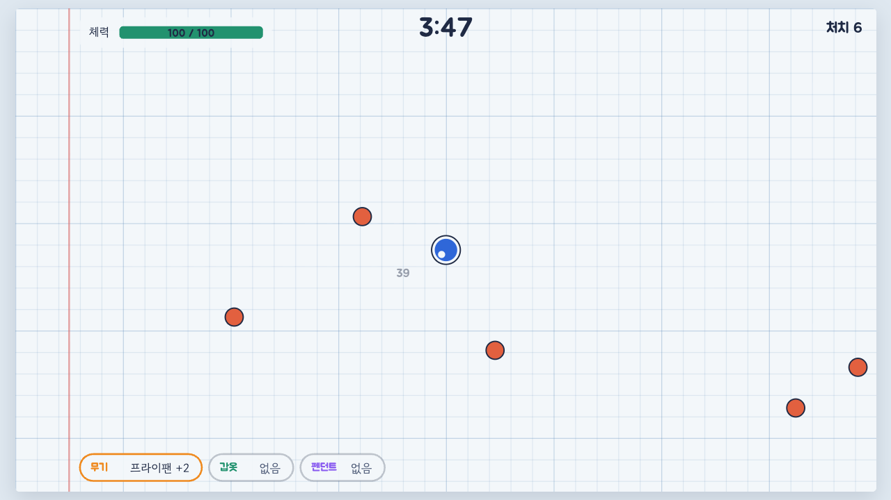
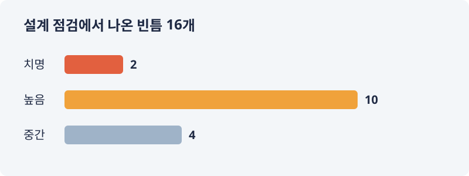
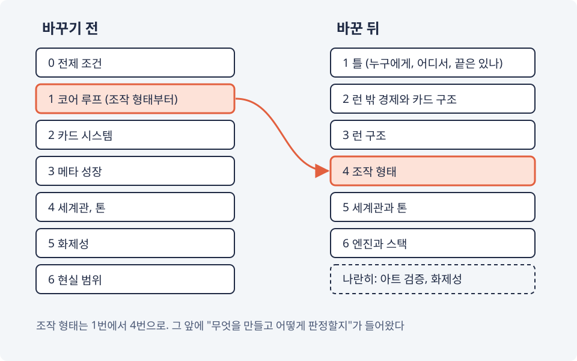

# 프로토타입부터 만들었다가 빈틈 16개
---

게임을 하나 만들어 보기로 했다. 혼자서, 주 5시간 남짓으로. 기획부터 코드까지 AI(Claude)와 같이 하고 있고, 이 글은 그 과정을 적는 개발 일지의 첫 편이다. 첫 편부터 자랑할 거리는 별로 없다. 대신 삽질은 넉넉하다.

## 메타포 세 개

출발점은 예전에 좋아했던 온라인 게임 세 개였다. 서바이벌 프로젝트(서프), 트릭스터, 요구르팅. 셋 다 서비스가 끝난 뒤에도 프리서버가 생길 만큼 다시 찾는 사람이 있었던 게임이다.

다만 셋을 따라 하려는 건 아니다. 끌렸던 것만 뽑아서 섞기로 했다.

- 서프: 부위별 장비 카드를 모으고, 강화하고, 부가옵션을 뽑는 재미
- 트릭스터: 지금 봐도 예쁜 아기자기한 그림과 맵
- 요구르팅: 프라이팬 같은 일상 소품이 무기가 되는 엉뚱함

그리고 원칙을 몇 개 세웠다. 짐작으로 논리를 펴지 않는다, 한 번에 확정하지 않는다, 사실과 제안을 섞지 않는다. 이 원칙들은 앞으로 나를 여러 번 구해 주고, 그만큼 여러 번 귀찮게 한다.

## 첫 제안은 Netty 서버였다

기획 첫날 받은 첫 제안은 이랬다. 방을 만들어 여럿이 들어가는 멀티 아레나에 채굴을 얹고, 클라이언트는 TypeScript(Phaser), 서버는 Java(Netty)로.

이 블로그 개발 카테고리에는 Netty 글이 두 편 있다. 그런데도 버렸다. 세 게임을 겉핥기로만 이해한 채 나온 안이었고, 내가 쓰던 스택을 굳이 따를 이유도 없었다. Netty 글 두 편이 게임 서버로 데뷔할 기회는 그렇게 날아갔다.

## 손이 먼저 나갔다

레포를 만든 날, 바로 프로토타입부터 만들었다. 질문은 하나였다. "장비 카드 한 장을 바꿨을 때, 자동 공격형과 직접 액션형 중 어느 쪽에서 더 크게 느껴지는가." 두 형태를 번갈아 4분씩 버티고, 판이 끝날 때마다 1~5점을 매기는 물건이었다.

*프로토타입 01. 모눈종이 위의 파란 원이 나, 빨간 원이 적이다. 손에 든 것은 프라이팬 +2.*

계획대로라면 이제 해 보고 점수만 붙이면 조작 형태가 정해질 차례였다.

## 냉정하게 봐 달라고 했더니

다음 날, 코드를 더 쓰기 전에 설계에 허점이 없는지부터 냉정하게, 빈틈없이 점검해 달라고 했다.

빈틈이 16개 나왔다.

치명적인 것만 두 개였다.

1. 이 게임의 핵심 재미는 판 밖에서 카드를 강화하고 옵션을 뽑는 데 있는데, 그 판 밖의 경제가 통째로 비어 있었다. 카드가 어디서 오는지, 강화 재료는 어디서 생기고 어디에 쓰이는지, 아무것도 정해지지 않았다
2. 끝이 있는 게임인지 끝없이 하는 게임인지도 정하지 않았다. 강화의 상한도, 콘텐츠 분량도, 값도 이 답에 달려 있는데, 로드맵에는 그 칸조차 없었다

그리고 방금 만든 프로토타입. 자동 공격형과 직접 액션형은 조작만 다른 게 아니었다. 한 번에 나오는 적의 수가 250 대 12, 카드가 떨어질 확률이 2.5% 대 10%, 회피가 있고 없고까지 같이 달랐다. 점수 차이가 나와도 그게 조작 때문인지 적 때문인지 가를 수가 없다. 매기는 사람도 만든 사람 한 명뿐이었다. 결론은 "이 프로토타입의 점수로는 조작 형태를 정할 수 없다"였다.

하나 더 있었다. 그 무렵 세운 첫 가설은 "강화한 카드는 한 장만 들고 판에 들어간다"였고, 장점으로 "다 키운 장비가 게임을 시시하게 만드는 문제가 그 한 칸에만 갇힌다"를 들었다. 그런데 같은 가설의 다른 규칙을 따라가 보니, 판 안에서 줍는 카드도 강화된 채로 나왔다. 끝까지 키우면 모든 칸이 최고 강화였다. 갇혀 있던 건 강화가 아니라 우리 생각이었다.

공정하게 적어 두자면, 점검한 쪽도 Claude였고 점검받은 설계를 같이 쓴 쪽도 상당 부분 Claude였다. 셀프 감사였다. 그래도 덕분에 숨어 있던 것들이 꽤 나왔다.

## 순서를 뒤집었다

로드맵을 다시 짰다. 맨 앞에 있던 조작 형태가 네 번째로 내려가고, 그 앞에 틀이 들어왔다. 누구를 위한 게임인지, 어디에 먼저 내는지, 끝이 있는지, 무엇으로 판정할지.

그날 틀부터 질문을 하나씩 답했다. 스팀에 먼저 내고, 첫 출시는 무료 체험판으로 하고, 본편은 끝이 있되 끝낸 뒤에도 끝없이 오르는 도전을 둔다.

배운 것은 한 줄이다. 무엇을 판정할지 정하기 전에 만든 프로토타입은 답을 주지 못한다.

물론 이걸 배웠다고 다음 프로토타입이 잘된 건 아니다. 그 이야기는 몇 편 뒤에 한다. 다음 편은 시뮬레이션 이야기다. 미리 말하자면, 결론은 "보류"다.
