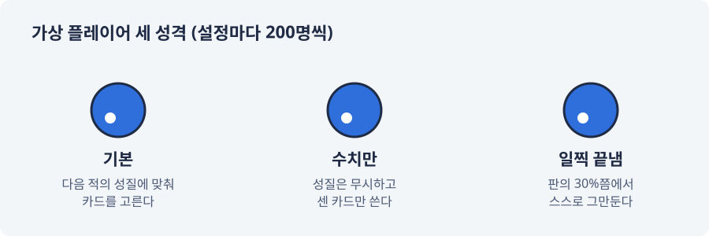
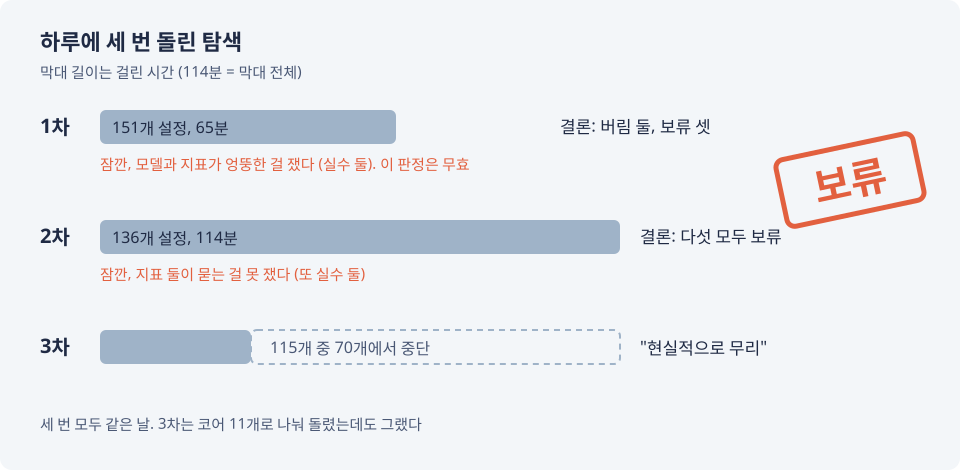

# 114분 돌린 시뮬레이션의 결론: 보류
---

지난 편의 교훈은 "무엇을 판정할지 정하기 전에 만든 프로토타입은 답을 주지 못한다"였다. 그래서 이번에는 판정 규칙부터 적었다. 규칙을 먼저 적고, 커밋하고, 그다음에 돌린다. 여기까지는 아주 모범적이었다.

## 판정 규칙부터 적었다

지난 편에서 통째로 비어 있던 판 밖 경제를 질문 하나씩 채웠다. 카드는 어디서 얻는지, 강화 재료는 어디서 생기고 어디에 쓰이는지, 판에는 무엇을 들고 들어가는지. 채운 답은 모두 가설로 두고, 수치 시뮬레이션으로 확인하기로 했다.

시뮬레이션이 답할 것은 정해 두었다. 재화가 모자라거나 넘치지 않는가, 어떤 행동 하나가 늘 정답이 되어 다른 행동을 지우지 않는가, 성장이 중간에 멈추지 않는가. 답하지 않을 것도 적었다. 재미. 시뮬레이션을 통과해도 재미있다는 뜻은 아니다.

처음 계산은 이랬다. 바꿔 볼 값 10개를 3개씩만 잡아도 조합이 약 6만 개, 여기에 가상 플레이어 500명, 한 명당 300판, 플레이어 성격 5가지를 곱하면 약 440억 판. 그냥 내가 직접 하는 게 빠르겠다 싶었지만, 그건 그것대로 몇 생이 걸린다. 범위를 체험판으로 줄이고, 성격은 셋, 한 명당 최대 100판으로 깎았다.

판정은 세 가지 중 하나로 낸다. 모든 기준을 함께 만족하는 설정이 있으면 확정, 어떤 설정에서도 안 되면 버림, 그 사이면 보류. 판정 규칙 문서는 지금 446줄이다.

## 1차: 65분, 그리고 "잠깐"

151개 설정을 65분 동안 돌렸다. 결론은 확정 없음, 가설 둘 버림, 나머지 셋 보류.

버림이 둘이나 나왔으니 바로 받아들여야 할까. 받아들이기 전에 확인해 봤더니 Claude의 실수가 둘 나왔다.

1. 옵션 재료는 가설대로라면 보스와 높은 난이도에서만 나온다. 그런데 모델은 프로토타입에서 임시로 쓰던 규칙("어느 판이든 끝까지 버티면 1개")을 그대로 가져와 있었다. 버림 판정 하나는 가설이 아니라 그 임시 규칙을 잰 것이었다
2. 다른 기준 하나는 "판에 들고 갈 카드 묶음을 늘 똑같이 고르게 되는가"를 물었다. 그런데 체험판에는 적의 성질이 하나뿐이다. 성질이 하나면 같은 묶음을 고르는 게 당연하다. 애초에 가를 수 없는 질문이었다

그래서 버림 둘은 무효. 고쳐서 다시 돌렸다.

## 2차: 114분, 다섯 모두 보류

이번엔 136개 설정에 114분. 결론은 다섯 가설 모두 보류였다. 가장 가까웠던 설정은 기준 하나만 0.806이 나와 떨어졌다. 통과 기준은 0.8 이하였다. 0.006 차이다.

그리고 다시 "잠깐".

- "카드 한 장의 운이 강화보다 판을 더 좌우하는가"를 재는 기준은, 비교용 가상 플레이어 대부분이 100판 안에 다음 난이도를 넘지 못해서 사실상 "100판"이라는 상한을 재고 있었다
- "성장이 중간에 끊기는가"를 재는 기준은 규칙끼리 서로를 막고 있었다. 한쪽 규칙은 난이도를 "15판쯤에 처음 깨도록" 맞추라고 하고, 다른 쪽은 "10판 안에" 깨야 통과라고 했다. 15판에 맞추면서 10판 안에 끝내라. 시험지가 먼저 틀려 있었다

다만 이번에는 시뮬레이션이 제 몫을 한 대목도 있었다. 적의 성질 하나가 너무 쉽게 풀려서, 성장을 막는 것이 성질이 아니라 그냥 수치였다. 그리고 체험판에서 옵션 뽑기를 할 기회가 1번뿐이었다. "체험판에 옵션 뽑기를 넣는다"는 결정과 "옵션 재료는 보스와 높은 난이도에서만 나온다"는 결정이 체험판 안에서 맞부딪친 것이다. 문서끼리만 대 봐서는 드러나지 않던 것을 시뮬레이션이 찾아냈다.

## 3차: 115개 중 70개에서 멈춤

또 고쳤다. 이번에는 오래 걸린다는 말을 듣고 설정들을 CPU 코어 11개로 나눠 돌렸다. 앞부분은 6분 만에 끝났다. 뒷부분 115개 중 70개쯤 돌았을 때, 진행 상황을 물어보다 결국 멈췄다. 너무 느리고, 이 방식으로 계속하는 건 현실적으로 무리였다.

나중에 보니 멈추는 게 맞았다. 3차는 맨 처음 기본값 하나로 돌려 본 단계에서 이미 결론을 뒤집을 조건이 보였다. 전체를 끝까지 돌릴 필요가 없었다. 중간까지의 결과도 그 조건 그대로였다.

## 남은 것

배운 것은 이렇다. "규칙대로 끝까지 돌린다"를 "이걸 돌리면 결정이 바뀌는가"보다 앞에 두면 시간이 녹는다. 지금은 탐색이 단계마다 남은 시간을 찍고, 30분이 넘을 것 같으면 돌리기 전에 먼저 묻게 해 두었다. 기본값 하나로 먼저 보고, 그걸로 결론이 보이면 거기서 멈춘다.

그리고 하나 더. 규칙을 먼저 적었다고 규칙이 맞는 건 아니었다. 두 번의 탐색에서 나온 실수 넷은 모두 "규칙과 모델과 기준을 서로 맞춰 보지 않은" 데서 나왔다.

이 시뮬레이션은 지금 멈춰 있다. 그 뒤에 프로토타입을 직접 해 본 내가 방향 자체를 다시 보기로 했기 때문이다. 그 이야기는 조금 뒤에 하고, 다음 편은 이런 실수들을 문장이 아니라 장치로 막아 보려던 이야기다. 장치를 만들다가도 실수는 났다.
