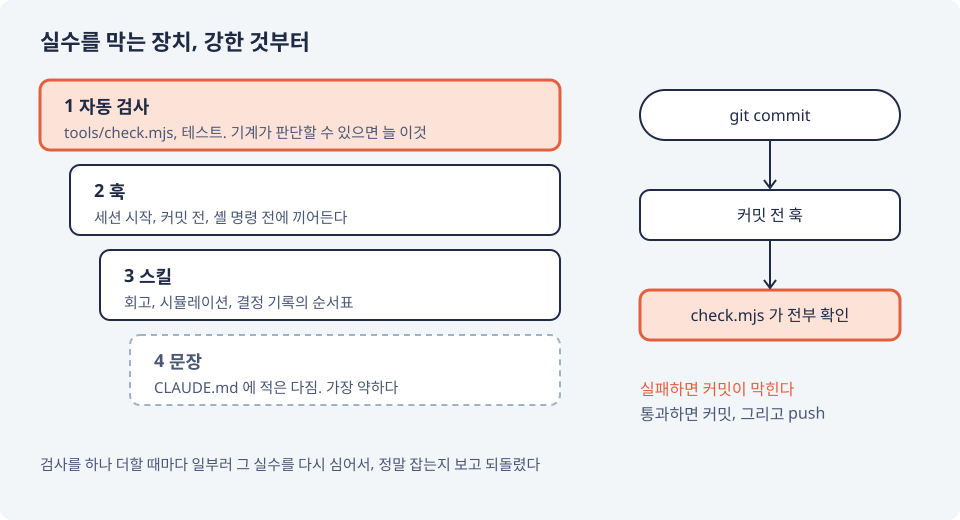
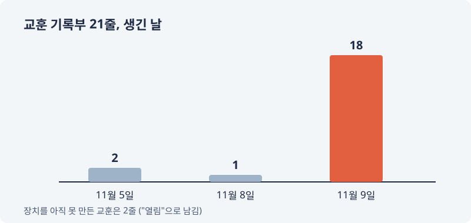

# 실수를 문장 말고 장치로 막기
---

지난 편에서 Claude의 실수가 넷 나왔다. 사람끼리라면 "다음엔 조심하자" 한마디로 넘어갔을 것이다. 그런데 새 세션의 Claude는 지난 세션의 다짐을 모른다. 다짐을 적어 둔 문서도, 읽지 않으면 없는 것과 같다.

그래서 다짐 대신 장치를 두기로 했다.

## 짚지 않아도 알아서 발전하는 하네스

요청은 한 줄이었다. 내가 짚지 않아도 알아서 발전하는 하네스를 만들어 달라.

그렇게 생긴 것들이다.

- 레포 검사(`tools/check.mjs`): 문서와 코드가 서로 맞는지, 바꾼 코드에 테스트가 따라왔는지, 모든 테스트가 도는지 본다
- 훅: 세션을 시작하면 지난번 멈춘 곳과 아직 못 막은 실수를 띄워 주고, 커밋하기 전에 검사를 돌려 실패하면 커밋을 막는다
- 스킬: 세션 마무리 회고, 시뮬레이션 수정, 결정 기록의 순서표
- 교훈 기록부: 실수마다 한 줄. 무슨 일이 있었고, 왜 났고, 무엇으로 막았는지

핵심은 장치에 강도가 있다는 것이다. 기계가 판단할 수 있으면 자동 검사, 정해진 순간에 끼어들어야 하면 훅, 사람의 판단이 필요하면 스킬. 문장은 어느 것도 안 될 때만 쓴다. 문장이 가장 약하기 때문이다.

검사를 하나 더할 때마다 일부러 그 실수를 다시 심어 보고, 검사가 정말 잡는지 확인한 뒤 되돌렸다. 여기까지는 또 모범적이었다.

## 장치를 만들다가 장치를 부쉈다

하네스를 만드는 도중에 사고가 났다. 정규식을 고치려고 `sed -i`를 썼는데, 바꾼 것이 정규식만이 아니었다. 파일 안의 `/`가 몽땅 바뀌면서 레포 검사 스크립트와 세션 시작 훅이 통째로 망가졌다. 둘 다 막 만든 새 파일이라 git으로 되돌릴 것도 없었다.

그래서 장치를 하나 더 만들었다. 검사가 모든 스크립트를 문법부터 읽어 보게 했다. 그리고 문장도 하나 적었다. "파일은 셸 치환이 아니라 편집 도구로 고친다."

같은 날, 그 문장이 적힌 채로 `sed -i`가 또 쓰였다. 이번엔 결과가 맞긴 했다. 하지만 문장이 실수를 하루도 막지 못한 건 분명했다. 결국 셸 명령을 실행하기 직전에 끼어드는 훅을 달아서, `sed -i`와 `perl -pi`로 파일을 고치려 하면 아예 막게 했다. 문장에서 훅으로, 한 칸 올린 것이다.

## 훅이 너무 성실했다

커밋하기 전에 검사를 돌리는 훅은 커밋 명령에만 반응해야 했다. 설정에 그런 조건도 적었다. 그런데 실제로는 모든 셸 명령마다 검사가 돌았다. 테스트를 아직 고치는 중이라 검사가 실패하는 상태였으니, `ls` 하나도 막혔다.

훅을 만든 세션에서는 설정이 아직 읽히지 않아 아무 일도 없었고, 설정이 읽힌 뒤에야 드러났다. 고친 방법은 단순하다. 설정의 조건을 믿지 않고, 검사가 받은 명령이 커밋인지 스스로 보고 아니면 바로 통과시킨다.

## 미래에서 온 기록 170곳

세션을 마치며 회고하다가 이상한 것을 찾았다. PC 시계도 커밋 시각도 11월 9일인데, 문서에는 그날 한 일이 "11월 10일"로 적혀 있었다. 31개 파일, 170곳. 날짜를 시계에서 읽지 않고, 앞선 기록의 날짜를 이어 적은 탓이었다.

그 뒤로 세션을 시작하면 훅이 이 PC 시계로 오늘 날짜를 띄운다. 그리고 이번 커밋에서 새로 더한 줄에 오늘보다 하루에서 사흘 뒤 날짜가 있으면 검사가 막는다. 이미 적힌 170곳은 얽힌 데가 너무 많아 그대로 두고, 바로잡는 줄을 하나 남겼다.

비슷한 일은 더 있었다. "작업은 여기까지 할거야"라고 세션을 끝냈는데, 세션을 끝내는 말을 알아듣는 훅이 그 말을 놓쳤다. 이건 잡아야 할 말 10개와 잡으면 안 되는 말 7개를 예문으로 두고, 검사가 그 예문으로 훅을 시험하게 했다.

## 21줄

교훈 기록부는 지금 21줄이다. 생긴 날을 세어 보면 이렇다.

11월 9일 하루에 18줄. 그날 일은 2편부터 5편까지에 고루 나온다. 21줄 중 2줄은 아직 장치를 만들지 못해 "열림"으로 남아 있다.

그리고 이 일지를 시작한 날에도 줄은 늘었다. 처음 레포를 만든 맥으로 돌아와 최신 내용을 받아 보니, 검사가 테스트를 돌리지 못해 커밋이 막혔다. 이 맥의 Node 26에서는 `node --test tests/`처럼 폴더를 넘기는 방식이 실패했다. 테스트를 인자 없이 돌리게 고쳤다. 하네스를 한 PC에서만 시험해 본 대가였다.

다만 이 하네스가 막는 것은 "규칙끼리 어긋나는 실수"까지였다. 방향이 틀린 것은 막지 못했다. 다음 편이 그 이야기다.
