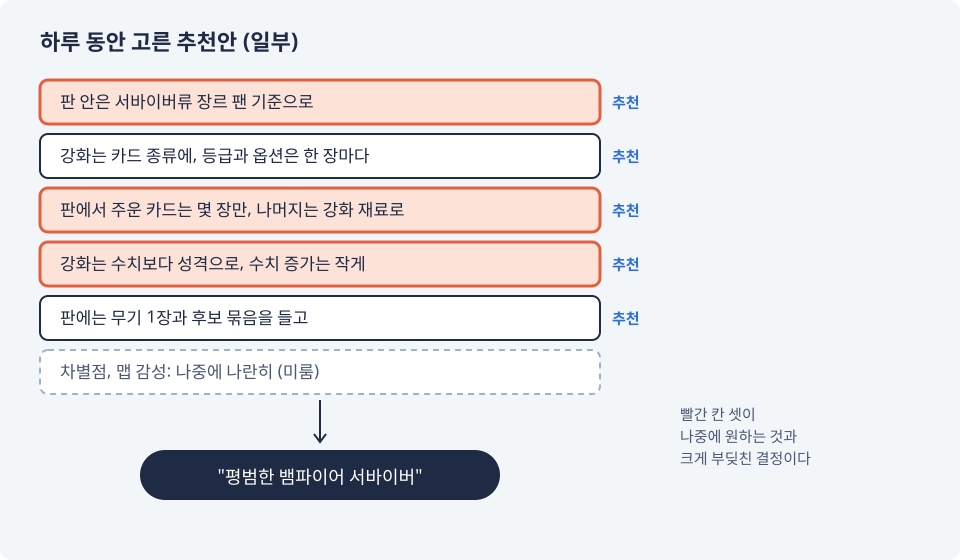
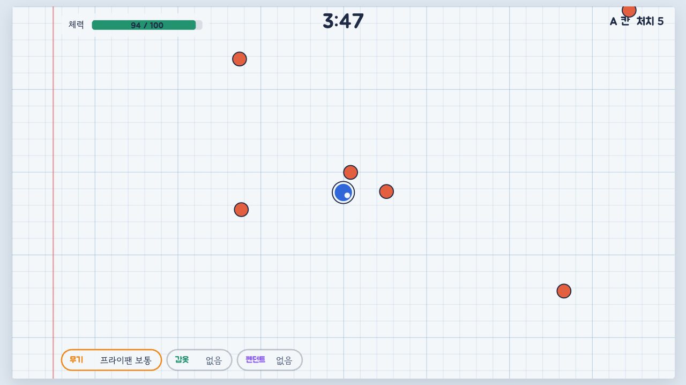
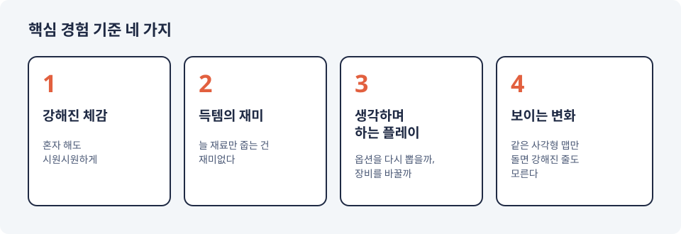

# 추천만 골랐더니 뱀파이어 서바이버가 되었다
---

이번 편은 반성문에 가깝다.

## 하루에 정한 것들

1편에서 로드맵을 뒤집은 날, 틀과 판 밖 경제를 질문 하나씩 정했다. 방식은 이랬다. Claude가 선택지를 내고 그중 하나에 "추천"을 붙인다. 나는 고른다.

그날 판 밖 경제 단계에서 고른 답은 하나도 빠짐없이 추천안이었다.

하나하나에는 이유가 붙어 있었다. 타깃이 둘(서바이버류를 즐기는 사람, 옛 한국 온라인 게임을 기억하는 사람)이니 판 안은 서바이버류 기준으로 맞추자. 판에서 주운 카드는 몇 장만 가져가고 나머지는 강화 재료로 바꾸자. 강화는 숫자보다 카드의 성격을 바꾸게 하자. 들어 보면 다 그럴듯했다.

같은 날 설계 점검은 "이 게임만의 차별점이 없다", "맵 감성이 드러날 자리가 없다"를 이미 짚어 두었다. 둘 다 "나중에, 나란히 본다"는 칸으로 들어갔다. 그리고 그 위에 경제를 쌓고, 시뮬레이션을 돌리고, 프로토타입을 만들었다.

## 프로토타입 02

판 밖 루프를 시험하는 프로토타입이었다. 한쪽 칸에는 보관함, 강화, 옵션 뽑기가 있고, 다른 칸에는 없다. 계획은 사흘 넘게 칸마다 아홉 판 이상 해 보고 판정하는 것이었다.

판정은 첫 플레이에서 끝났다. 해 보고 남긴 말은 이랬다.

- "내가 원한 건 이런 게임은 아니다. 그냥 평범한 뱀파이어 서바이버 같은 게임이다. 아류작도 너무 많다"
- 판 밖 루프는 "굉장히 지루하다"
- "별다른 차별점도 못 느끼겠다"

*프로토타입 02. 1편의 프로토타입 01 화면과 나란히 놓고 다른 그림 찾기를 해 보면, 난이도가 꽤 높다.*

그리고 한 줄을 더 남겼다. "추천대로만 골랐는데 양산형으로 만들어지고 있었다."

## 무엇이 잘못됐나

다시 대 보니, 원하는 것과 크게 부딪친 결정이 셋이었다. 판 안을 서바이버류로 둔 것, 판에서 얻는 것이 대부분 재료가 되는 것, 강화의 수치를 작게 둔 것. 셋 다 그날 고른 추천안이다. 위 그림의 빨간 칸이 그것이다.

원인은 하네스가 보지 않던 부분에 있었다. 하네스는 규칙끼리 맞는지는 꼼꼼히 봤지만, 방향이 처음 끌렸던 것과 맞는지, 남과 다른지는 보지 않았다. 추천을 낼 때도 그 안이 처음 끌렸던 지점에서 얼마나 멀어지는지는 적지 않았다. 추천을 낸 쪽도, 고른 쪽도, 그날은 방향을 묻지 않았다.

## 핵심 경험 기준 네 가지

그래서 원하는 것을 내 말로 적었다. 네 가지다.

1. 강해진 체감: 아이템을 올리면서 강해졌다는 것이, 혼자 하는 플레이에서도 시원시원하게 느껴져야 한다
2. 득템의 재미: 직관적이어야 한다. 늘 재료만 파밍하는 건 재미가 없다
3. 생각하며 하는 플레이: "이 상황에선 이 아이템이면 돌파하겠다", "이건 아쉽다, 옵션을 다시 뽑을까, 장비를 바꿀까" 하고 머리를 굴리는 게임
4. 보이는 변화: 같은 사각형 맵만 돌아다니면 강해졌는지도 느껴지지 않는다

이제 모든 결정과 추천은 이 네 가지에 대 본다. 세션을 시작하면 훅이 이 네 줄을 먼저 띄우고, 선택지를 낼 때는 안마다 네 기준에 맞는 점과 부딪치는 점을 적는다. 미뤄 둔 방향 문제가 있으면 그 위에 쌓기 전에 먼저 묻는다.

## 그리고 다시

이 기준으로 판 안의 형태를 다시 골랐다. 후보는 둘이었다. 던전 하나를 구역마다 지나며 장비를 줍는 구역 탐험형, 그리고 스테이지를 골라 준비하고 도전하는 공략 스테이지형. Claude는 구역 탐험형을 추천했다.

나는 그걸 골랐다. 또 추천안이었다. 이번에는 네 기준에 대 본 표가 붙어 있었다는 점이 달랐다.

그 결과는 다음 편에.
