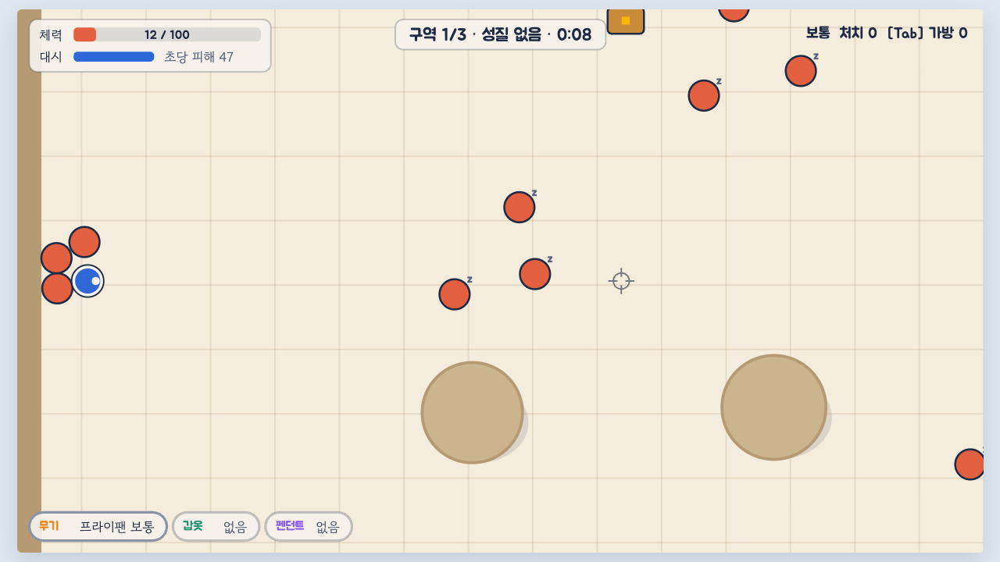
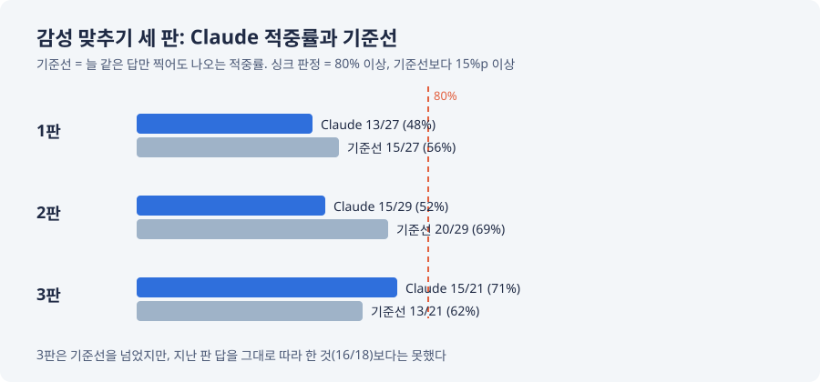
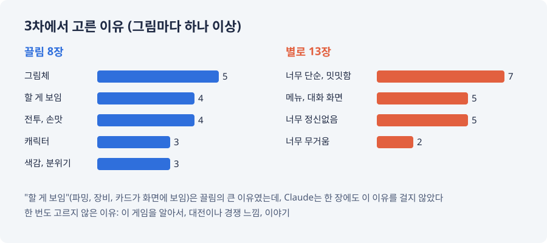

# "02와 똑같다", 그리고 감성 맞추기 세 차례
---

지난 편 끝에서 구역 탐험형을 골랐다. 이번 편은 그걸 만들어 본 이야기, 그리고 그다음에 그림으로 감성을 맞춰 보려던 이야기다.

## 프로토타입 03

이번엔 순서를 지켰다. 판정 규칙을 먼저 적고, 조작은 직접 액션으로 골랐다. 자기가 만든 것도 억지로 좋게도 나쁘게도 보지 말고 중립적인 비평가의 눈으로 다시 보는 단계를 늘 두자고 요청해서, 만들기 전과 만든 뒤에 비평가 점검을 적게 했다.

던전 하나에 구역 셋과 보스 방. 구역마다 적의 성질이 다르다. 맞을 때 피해를 깎는 단단한 적, 멀리서 쏘고 물러나는 적. 떨어진 장비는 그 자리에서 주워 바로 바꿔 낀다. 판 사이에는 장비를 고르고, 분해하고, 옵션을 뽑고, 강화한다.

화면 없이 판을 도는 봇으로 먼저 돌려 봤더니, 첫 판 봇이 1구역에서 20초를 못 버텼다. 수치를 고쳤다.

*프로토타입 03, 1구역 8초째. 가만히 서 있으면 이렇게 된다(체력 12). 처음엔 봇도 여기서 20초를 못 버텼다.*

## "02와 똑같다"

처음 몇 번은 예전에 띄워 둔 서버에서 프로토타입 02를 열고 "달라진 게 없다"고 했다. 주소를 바로잡아 03을 열었다. 그리고 해 본 뒤의 말.

- "똑같은데 그냥 원래랑 비교했을 때 자동으로 공격 나가던데 내가 수동으로 해야 하는 거 차이 정도잖아"
- "나는 이런 감성을 원하는 게 아니라니까? 자꾸 프로토타입을 만들어야 한다는 강박에 이러는 거면 그러지 않아도 돼. 퀄리티가 너무 구려"
- "프로토타입은 꼭 실제 플레이가 아니어도 돼. 컨셉 아트라든지 다른 방식으로라도 상관이 없어"

Claude가 만든 뒤에 적은 비평가 점검은 03을 흔한 장르와만 비교했다. 작은 디아블로 같다는 식이었다. 바로 직전에 내가 기각한 02와는 비교하지 않았다. 그래서 돌아간 질문이 "뭐가 작은 디아블로냐"였다.

틀린 이유는 둘이었다. 03은 02와 같은 그림과 코드에 구조만 바꾼 것이라, 해 보는 사람 눈에는 02와 같은 게임이었다. 그리고 둘 다 모눈종이 위의 원과 사각형이라, 내가 원한 감성이 맞는지는 처음부터 물을 수가 없었다. 그 뒤로 비평가 점검에는 "직전과 같은 점"을 반드시 적고, 새 프로토타입은 만들기 전에 "왜 이 질문을 이 형태(플레이, 그림, 글)로 묻는가"를 적게 했다.

## 감성 맞추기

그래서 플레이 대신 그림으로 가기로 했다. 내가 끌렸던 옛 게임 화면 여섯 장을 건넸다(다른 회사 게임 화면이라 여기에는 싣지 않는다). Claude는 그림을 읽고 감성을 글로 정리했다. 내 답은 "말로만 알려 주는 건 의미가 없다, 싱크가 맞아야 한다"였다.

그래서 맞혀 보기로 했다. 공개된 스팀 상점 스크린샷을 모아, 내가 보기 전에 Claude가 그림마다 끌림인지 별로인지 먼저 걸고 커밋한다. 그다음 내가 클릭으로 답한다. 맞힌 비율이 80%를 넘고, 늘 같은 답만 찍어도 나오는 비율(기준선)보다 15%p 이상 높으면 "싱크가 맞다".

세 차례 했다.

1차, 2차는 기준선보다도 낮았다. 2차에서 하나 건진 것은, Claude가 싫어할 거라고 본 쪽(무거운 3D, 대전 연출, 적 떼만 있는 빈 바닥)이 열 장 중 아홉 장 맞았다는 것이다. 싫은 건 잘 맞히고, 좋은 건 못 맞혔다. 맛집 추천은 못 해도 피해야 할 집은 아는 친구가 된 셈이다.

3차에는 그림마다 이유를 하나 이상 고르게 했다. 앞의 두 차례는 끌림과 별로만 모아서, 왜 그런지 알 길이 없었기 때문이다.

이유를 모으자 한 번 만에 보이는 게 생겼다. 끌림의 큰 이유는 "할 게 보임", 화면에 파밍할 것과 장비와 카드가 보이는 것이었다. Claude는 21장 중 어디에도 이 이유를 걸지 않았다. 별로의 첫째 이유는 어둡거나 무거운 게 아니라 "너무 단순, 밋밋함"이었다.

3차의 적중률은 71%로 기준선을 넘었다. 다만 지난 차례의 답을 그대로 따라 했으면 더 잘 맞혔을 것이다. 싱크가 맞았다는 판정은 끝내 한 번도 나오지 않았고, 나는 "3차까지 했으면 할 만큼 한 것 같다"며 거기서 멈췄다.

## 현재 상황

세 차례에서 남은 기준은 이렇다.

- 끌리는 것: 할 게 보이는 화면, 공들인 그림체와 캐릭터, 손맛 있는 전투
- 끌리지 않는 것: 밋밋함, 정신없음, 메뉴가 화면을 차지하는 것

다음은 이 기준과 지금까지의 결정을 대 보고, 컨셉 아트로 "이거다, 아니다"를 가리는 것이다. 이번엔 원과 사각형 말고 그림으로.

여기까지가 10월 말부터 11월 9일까지의 이야기다. 메타포 세 개로 시작해서, 프로토타입 셋, 시뮬레이션 세 번, 감성 맞추기 세 차례를 거쳤지만, 아직 무슨 게임인지 한 줄로 말하지 못하는 상태다. 이 일지는 여기서부터 이야깃거리가 모일 때마다 이어 간다.
